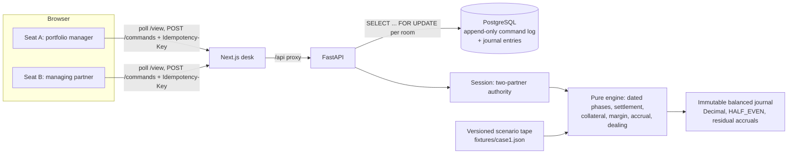

# FundForge

A two-player cooperative hedge-fund game built on a real double-entry accounting engine. You and a partner run a fictional $25m long/short fund through ten days of crisis: the prime broker recalls a borrowed short, a market shock triggers stressed margin, investors redeem, and the separate management company still has to make payroll. Every dollar moves through an immutable journal, so the debrief can show exactly what happened and why.

[](https://github.com/krishbansalofficial/fundforge/actions/workflows/ci.yml)

## Play it locally

```bash
docker compose up --build        # Postgres, FastAPI on :8000, Next.js on :3000
```

Open <http://localhost:3000> and choose **Open the fund**. You get two seat links: open one yourself and send the other to your partner, or open it in a second browser. Time advances only when both partners press Ready.

## What makes it a fund and not a trading app

| Mechanic | What the engine enforces |
|---|---|
| Fund versus firm | The investor fund and the management company keep separate journals. The firm's payroll can only be paid from firm cash, and fund money reaches the firm only as fee payments. |
| LP series | Seed, Patient and Tactical hold separate unit series. Each series carries its own high-water mark and a reversible 20% performance provision, plus a 1.5% ACT/365 management fee charged on every calendar day, weekends included. |
| Short financing | Borrow fees run ACT/360 on settled borrowed shares. Short proceeds sit in restricted collateral, and a recall forces a cover or a replacement borrow before a deadline. |
| Margin | Maintenance and initial requirements switch to stressed coefficients after the shock. An uncured deficit leads to broker-forced liquidation. |
| Execution | Orders fill at the next market event, never at a price already published. Fills pay quadratic market impact and are capped at 5% of event volume, so splitting an order doesn't avoid the impact. |
| Governance | The PM can trade small tickets alone. Anything larger needs the other partner's signature on a SHA-256 digest of the exact package. Edits invalidate signatures, and nobody can approve their own proposal. |

## Architecture



Postgres stores only the accepted commands and the journal entries they produced. State is rebuilt by replaying the command log against the hashed scenario tape, and identical inputs produce an identical journal digest.

## Evidence

Run `cd backend && uv run pytest`; set `DATABASE_URL` to include the Postgres tests. CI runs everything against a real Postgres service.

- **Accounting oracles.** The isolated worked examples in [FUND_ACCOUNTING §6](docs/FUND_ACCOUNTING.md) run as tests: HWM crystallization, provision reversal, cohort allocation, partial redemption and residual rounding.
- **Property tests (Hypothesis).** Every entity's trial balance stays at zero, replay is idempotent, and pro-rata allocation conserves cents.
- **Scenario paths.** Scripted Case1 strategies run from day 12 to day 21. Positions, series and journal are reconciled after every event.
  - Early reduction ends in WIN.
  - Replacement borrow plus a cure ends in WIN.
  - Doing nothing ends in SURVIVAL via a forced buy-in.
  - Keeping the full short ends in forced margin liquidation.
- **Concurrency.** Separate Postgres connections race each other:
  - Duplicate signatures authorize exactly once.
  - Concurrent retries of one key create one order.
  - Simultaneous Ready clicks advance time exactly once.
- **Review.** A bounded finance review found four accounting bugs. Each one is fixed and has a regression test.

Design write-ups: [docs/ENGINEERING.md](docs/ENGINEERING.md) (the self-checking ledger, fund/firm separation, approval races, no future information).

## Repository

| Path | Contents |
|---|---|
| `backend/src/fundforge` | `money`, `journal`, `series`, `risk`, `execution`, `tape`, `engine`, `governance`, `store`, `api` |
| `frontend/app` | Landing page and the two-seat desk, including ribbon, book, feed, committee, ledger and debrief |
| `fixtures/case1.json` | Authored Case1 tape: defaults are materialized and validated at load |
| `docs/` | The specification. Active plan: [REPLAN_V3](docs/REPLAN_V3.md). Progress: [PROGRESS](docs/PROGRESS.md) |

## Status and scope

The Case1 vertical slice is implemented. Next come deployment and a recorded two-person playtest. The full 60-day, six-chapter campaign is specified in the design docs and is planned work, not finished work. All money, entities and investors are fictional. There is no brokerage connection, no real capital and no investment advice.
