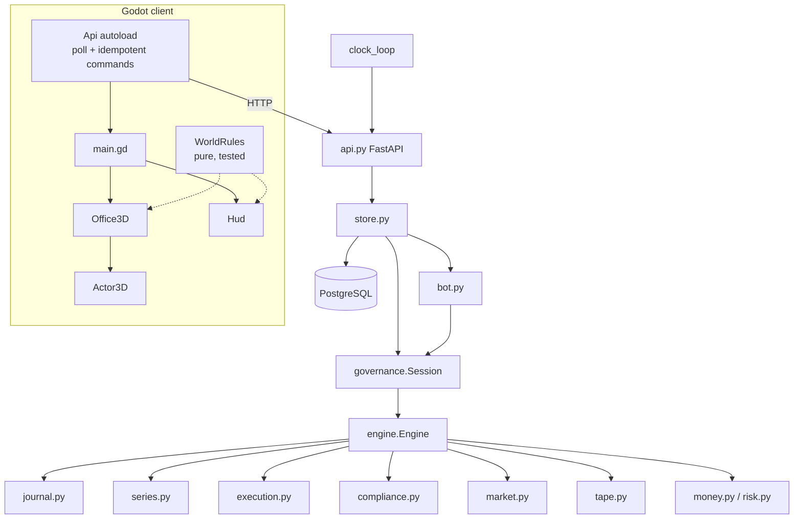

# Architecture

This describes the working code through 10 October 2026: HEAD `7b066f2` plus the preserved working-tree changes and Forge Terminal continuation. The design-time interfaces are in [SIMULATION_ARCHITECTURE](SIMULATION_ARCHITECTURE.md), the financial conventions in [FUND_ACCOUNTING](FUND_ACCOUNTING.md) and the game rules in [GAME_SYSTEMS](GAME_SYSTEMS.md). Current continuation evidence is in [HANDOFF](HANDOFF.md).

The design has one rule: **one economic authority**. The pure Python domain (`backend/src/fundforge/`) and the PostgreSQL command log decide every number. Clients only render the as-of view and send commands.

## Domain modules (`backend/src/fundforge/`)

| Module | Responsibility |
|---|---|
| `money.py` | `D()` parses money from `str`/`int` only; floats and bools are rejected. `cents()` rounds HALF_EVEN. `CTX` is the 40-digit decimal context. `Accrual` carries sub-cent remainders. `allocate()` splits an amount by weights, residual included. |
| `journal.py` | Immutable double-entry `Entry` objects. Each one balances within one entity (`fund` or `firm`). Entry IDs are economic identities: posting identical content again does nothing, and reusing an ID for different content is an error. `post_many` posts cross-entity pairs atomically. `digest()` is the SHA-256 of the canonical entries. |
| `series.py` | LP series: units, HWM, net capital and a reversible performance provision (20%). Participation = net + provision. Common P&L is allocated by opening participation. Management fee is 1.5% ACT/365. Annual crystallization, and redemption with pro-rata crystallization (the remaining HWM is unchanged). |
| `execution.py` | Quadratic impact `C(Q) = ref·Q·[half_spread + k·(Q/V)²]/10,000` over the *cumulative* same-side quantity in an event, plus a participation-capped `capacity()`. |
| `risk.py` | Gross and net exposure, and margin requirement from per-side rates. |
| `tape.py` | Loads an authored scenario and **materializes every default** into explicit `MarketEvent` records. Each business day has the phases `OPEN_ADMIN, PUBLIC_MARK, EXEC_A, EXEC_B, CLOSE`. It applies the variant's overrides. A missing or malformed record raises `TapeError`. The materialized tape is hashed (`tape.digest`). |
| `compliance.py` | `Ruleset` is versioned Decimal data with a gross band, net band, issuer cap, exemptions and a restricted list. `evaluate()` refuses an order only when the resulting book breaks a limit *and* the order makes it worse, so de-risking is always legal. `Ruleset.digest` is bound into every package digest. |
| `market.py` | The endogenous market (see below). |
| `engine.py` | The dated Case1 session engine (see below). `RULES_VERSION = "case1-rules-2026.10.3"`. |
| `governance.py` | `Session`: two-partner authority, packages, ready, the real-time clock and chat (see below). |
| `bot.py` | `bot:v1`, the solo partner policy (see below). |
| `store.py` | The PostgreSQL authority: rooms, seats, command log, journal, cache, clock scheduling and `verify` (see below). |
| `api.py` | FastAPI routes and the clock loop. |
| `terminal.py` | Read-only processed-event quotes/history, signed holdings, weighted borrow APR and static Decimal stress. See TERMINAL.md for the information boundary. |

### Engine event phases

`Engine.advance()` processes events up to the next decision barrier, which is the point just before an `EXEC_A` or `EXEC_B` event. At every event, the market impact multiplier first decays, then the effective marks are recomputed and the books are re-marked. The phase handler then runs:

- **`OPEN_ADMIN`:**
  1. publish scheduled notices;
  2. settle pending trades (a cash shortfall is recorded as a failed settlement that stays pending, never as negative cash);
  3. transfer an accepted replacement borrow on its transfer day;
  4. true up restricted collateral;
  5. pay what is due in priority order: redemptions, then management fees, performance fees and interest;
  6. repay debt above the treasury buffer.
- **`PUBLIC_MARK`:** notices; re-mark; open the recall on its announce day; reveal research assigned the previous day (the crowding report is generated from live rival and own positions at reveal time); true up collateral; publish a margin call if there is a maintenance deficit.
- **`EXEC_A` / `EXEC_B`** (`_execute`):
  1. reset the per-event participation capacity;
  2. rivals trade on public marks and their flow moves prices;
  3. queued orders fill, each re-checked against initial margin and the mandate at live marks;
  4. at the recall deadline, an unresolved recall becomes a forced buy-in;
  5. an uncured margin call becomes forced liquidation (largest longs first, then shorts);
  6. our own net flow is pushed into market impact;
  7. collateral is trued up and the margin call is re-evaluated.
- **`CLOSE`:** expire unfilled orders; accrue payroll in the firm (paid every 5th day from firm cash only; anything unpaid becomes an incident); accrue fees and interest for **every calendar date** up to the next event; invoice on day 20; deal redemptions.

`reconcile()` runs after every event under `localcontext(CTX)`. It checks the trial balances against economic state: securities against positions × marks, series capital and provisions against series state, NAV against the sum of series capital, and it enforces nonnegative fund/firm cash, the credit limit and nonnegative collateral. These are explicit guards raising `InvariantError(code, detail, day, phase)` and remain active under Python `-O`/`-OO`. Opening total units are guarded before allocation. Session restores its snapshot on failure; Store rolls back the transaction and never publishes the failed private copy. Direct Engine callers must discard a failed transition. Tests: `test_invariants.py`; compatibility rationale: ENGINEERING §6.

Notices are typed: `{code, refs, day, date, phase, kind, text}`. Clients and the clock react to `code` and `kind`; `text` is only presentation. The Win, Survival and Distress tier in `outcome()` still classifies incident strings by substring, and typed incidents are planned.

`outcome()` returns:
- the tier;
- `score()`: excess unit return in bps over a cost-free passive hold of the opening book, minus `FORCED_PENALTY_BPS = 150` per forced action;
- the rank in `league()`;
- the variant;
- the journal and tape digests.

### Series, execution and compliance in the engine

- **Fees.** `_accrue_date` accrues borrow fees and debit interest (ACT/360), allocates common P&L by opening participation, then posts each series' management fee through its `Accrual` as a fund/firm pair. Performance provisions are re-provisioned against the HWM.
- **Fills.** `_fill` enforces reduce-only semantics: reversing a position needs separate close and open legs. Shorts need borrow inventory. A fill is capped at `participation × volume` per event and per symbol, counting both sides. Limit orders currently step their quantity down by 5% at a time (exact bisection is ROADMAP P1).
- **Short sales.** Proceeds go to restricted collateral. `_collateral_target` nets earmarked proceeds per symbol.

### Market: rivals, permanent impact, resilience

`Market` holds a per-instrument multiplier `mult` around 1:

- **Effective mark:** `tape mark × mult`, quantized to 6 dp.
- **Impact** (`push`): `mult ← mult × (1 + impact × flow / volume)`, clamped to `1 ± 0.15`. Case1 uses `impact = 0.5`.
- **Resilience** (`decay`, every event): `mult ← mult + (1 − mult) × resilience`. Case1 uses `resilience = 0.25`.

The five rivals are deterministic agents with their own cash, positions and status (`active`, `deleveraging`, `liquidating`, `closed`):

- `crowded_short` deleverages 35% on a margin breach;
- `momentum` and `mean_reversion` react to moves of more than 1%;
- `macro` trades BEAM and BOND on BEAM moves of more than 2%;
- `activist` sells 30% of its longs after a drawdown of more than 8%.

Together the rivals may trade at most `max_participation = 10%` of volume. A rival with NAV ≤ 0 liquidates. Rivals see only public marks. `league()` and `crowding_report()` are the only public outputs.

### Governance (`governance.py`)

- **One entry point.** `Session.handle(user, key, command)`:
  1. **Idempotency.** A key maps to the SHA-256 fingerprint of `(user, command)`. A retry returns the stored result, and reusing a key for a different command is rejected.
  2. **Registry dispatch.** `COMMANDS` is built from the `_cmd_*` methods. An unknown type is a `CommandRejected`, never a 500.
  3. **Atomic commands.** The session state is deep-copied before the handler runs and restored on any exception. A rejection leaves no trace, so a sign whose second order fails leaves no first order live.
  4. Every accepted command clears readiness except `ready` itself.
- **Commands:**
  - `ticket` (PM only; ≤5% NAV, ≤15% opening-NAV turnover, mandate);
  - `propose`; `sign` (other partner, exact digest, not expired, mandate re-checked);
  - `cancel`; `research`;
  - `accept_replacement` and `set_reserve` (MP only);
  - `ready`; `set_speed`; `pause`;
  - `say` (1–240 characters, optional `ref`);
  - `tick` (clock only).
- **Digest-bound approvals.** `digest = sha256(canonical([POLICY_VERSION, mandate.digest, package_id, sorted orders, expires_cursor]))`. A package expires after one execution window.
- **Version-bound ready.** `ready` may carry the `version` the player saw. If anything was accepted since, it is refused as stale. When both partners are ready, pending packages expire and the engine advances.
- **The clock as a system actor.** The user `clock` may send only `tick`, and humans may not send `tick`. A tick carries `expected_version` and is refused if stale or paused. Before advancing, it auto-pauses if a package is pending. After advancing, it auto-pauses on any new notice or incident and at season end, recording the reason.
- **Chat.** The `say` command appends to `chat`, and the view returns the last 40 messages.
- **View.** `view(user)` is built only from processed events; the tape stays server-side. It includes fund vitals, positions, series, firm, recall, research, orders, packages, notices, league, incidents, decisions, clock state, chat and, at the end, `outcome`.

### Bot (`bot.py`)

`plan(session, role)` is a pure function of session state. It returns the commands the bot wants to send:

1. countersign the human's pending packages, or explain the refusal;
2. as MP, the borrow research and accepting the replacement;
3. as PM, covering recalled BRIN and curing a margin call within the ticket limit;
4. ready when the human is.

`act()` runs the plan for up to 6 bounded rounds through `Session.handle`, and posts a `say` for each referenced action. The store calls `act()` inside the same transaction as any non-bot command, clock ticks included. Each bot command is persisted as its own row. Replay applies the logged rows and **never re-runs the policy**.

### Store (`store.py`) and migrations

Numbered SQL files in `migrations/` are applied once each by `Store.init()`, under a Postgres advisory lock, and recorded in `schema_migrations`:

| Migration | Adds |
|---|---|
| `0001_init.sql` | `rooms`, `seats` (hashed tokens), `commands` (`unique(room_id, idem_key)`), `journal_entries`; append-only triggers |
| `0002_verifiable_books.sql` | `rooms.rules_version`; `commands.journal_digest_after` and `chain_hash`; `journal_lines` (`numeric(20,2)`, non-zero) with a **deferred constraint trigger** that rejects any entry with fewer than 2 lines or a non-zero sum at COMMIT; append-only and **TRUNCATE-refusing** triggers on all three log tables; the `trial_balance` view |
| `0003_realtime_clock.sql` | `rooms.running`, `speed`, `next_tick_at`, and a partial index for due rooms |
| `0004_scenario_variants.sql` | `rooms.variant` (drawn secretly at creation) |
| `0005_solo_bot.sql` | `rooms.bot_role` |

- **Pins.** A room pins its scenario, variant, tape digest and `RULES_VERSION`. A room whose pins don't match the running code is refused with `RoomIncompatible` and never re-derived under new rules. The clock parks such rooms.
- **`apply()`.** One transaction:
  1. lock the room row;
  2. return the stored result for a known key (or reject a reused key);
  3. take the cached session at this version, or replay it;
  4. **deep-copy it** and apply the command, then any bot commands;
  5. for each step, append the command row with `journal_digest_after` and `chain_hash = sha256(canonical([prev, seq, key, user, command, result, digest_after]))`, plus its journal entries and lines;
  6. update version and clock scheduling.

  The cache (LRU of 256 rooms) only ever holds committed versions and is never mutated.
- **`verify(room)`.** Under repeatable read, rebuild a fresh session and replay every command. For each one, compare the result, the journal digest and the chain link. Then compare the replayed entries with the stored entries, and the engine's balances with the SQL `trial_balance`. It returns the version, journal digest, chain head, entry count, rules version and tape digest.

### API (`api.py`)

The terminal adds authenticated `GET /api/rooms/{room_id}/terminal`, using the same `Store.session()` consistent-version read as the desk. Engine observations are captured only after processed events reconcile and are reconstructed by command replay. The projection never exposes the raw tape or authorizes a trade. No new database table, broker or cache was added. Client classes `ForgeTerminal`, `TerminalRules` and `TerminalChart` provide controls, parsing and observed-event plotting. The UI polls on version changes plus a two-second visible-only connection heartbeat; unchanged snapshots preserve controls. Full contract: [TERMINAL](TERMINAL.md).

| Method and path | Purpose |
|---|---|
| `GET /api/health` | Liveness |
| `POST /api/rooms` | `{scenario, pm_name, mp_name, solo_role?}` returns the room ID, seat tokens, names and `bot_role` |
| `GET /api/rooms/{id}/view` | The as-of view plus `names` and `realtime` (running, speed, `next_tick_in`, `window_seconds`, server time). Requires `Authorization: Bearer <seat token>`. |
| `GET /api/rooms/{id}/ledger?entity=fund\|firm` | Journal entries (up to 1,000) and the digest |
| `POST /api/rooms/{id}/commands` | A command with the `Idempotency-Key` header. 409 for a reused key or an incompatible room; 422 for a rejection. |
| `GET /api/rooms/{id}/verify` | `{ok, ...verify}` or `{ok: false, error}` |
| `GET /api/rooms/{id}/terminal` | Authenticated consistent-version public quotes, observed history, static risk, published news, orders and league. No command or journal mutation. |

The lifespan starts `clock_loop` (disable it with `FUNDFORGE_CLOCK=0`). Every 0.25 s, the loop logs a `tick` for every due running room. Window length is `FUNDFORGE_SECONDS_PER_WINDOW` (default 8) divided by speed. Because ticks are idempotent per version (`tick-{version}`), two schedulers racing still produce one tick.

## Game client (`game/`, Godot 4.7, Forward+)

| Script | Role |
|---|---|
| `api.gd` (autoload `Api`) | Polls `/view` every 0.5 s and emits `view_changed`. `command()` sends one idempotency key and retries a network failure once **with the same key**. Also wraps `create_room`, `ledger` and `verify`. |
| `world_rules.gd` (`WorldRules`) | Pure presentation rules, unit-tested headless: the location map and hit tests, the phase-to-hour map, clock interpolation bounded by the server schedule, daylight colour, notice-code effects (`EFFECTS`), the partner's location from their last command, money formatting, league rows and beacon colours. It cannot change money, time or outcomes. |
| `office3d.gd` (`Office3D`) | Builds the 3D office and street: • Kenney CC0 furniture and city models; Poly Haven PBR materials, HDRI sky and props. • Lighting: SDFGI, SSR, SSIL/SSAO, volumetric fog and tilt-shift DOF. `FF_QUALITY=low` turns the heavy effects off. • Daylight follows the in-world hour. • Effects: screens turn red or green, an alarm, the halt board, rival towers flash on blow-ups. • Input: click to walk, arrows, camera rotate and zoom, `E` to interact. |
| `actor3d.gd` (`Actor3D`) | Animated people: Quaternius CC0 humans, falling back to Kenney blocky characters, with clip mapping and `walk_to`. |
| `hud.gd` (`Hud`) | Clock and speed buttons, fund vitals, the desk feed (notices and chat), the location terminals and the debrief. |
| `main.gd` | The menu (solo PM, solo MP, open a duo fund, join by `room:token`), dev flags, and the wiring of views into effects. |

## Frontend (`frontend/`, Next.js 15, React 19)

- **`app/page.tsx`.** The landing page, which creates a two-seat room.
- **`app/room/[id]/`.** The earlier web desk (`desk.tsx`). It has a deadline ribbon, approvals, ledger and debrief.
- **Discoverability.** `layout.tsx` metadata, `opengraph-image.tsx`, `robots.ts` and `sitemap.ts`.
- **API access.** `next.config.ts` proxies `/api/*` to the FastAPI service, so the browser makes same-origin calls only.

This client predates the Godot game and is kept as a secondary client. It has no solo mode.

## Data flow

1. A client sends `POST /commands` with an `Idempotency-Key`.
2. `Store.apply` locks the room, replays or reuses the session, applies the command (and the bot's replies) to a private copy, then appends hash-chained command rows and SQL-checked journal lines in one transaction.
3. Clients poll `/view`, which is built from the committed session.
4. The world reacts to typed notice codes.

## Determinism and replay guarantees

- **Fixed inputs.** All economics use `Decimal` in a fixed 40-digit HALF_EVEN context, and there are no floats in money paths. Iteration orders are sorted. No wall-clock time, randomness or network input reaches the engine. The variant is drawn with `secrets` at room creation and then pinned.
- **Pins.** A room's state is a pure function of its pinned tape (digest), `RULES_VERSION`, variant, bot role and ordered command log. Any change to economic rules must bump `RULES_VERSION` and regenerate `backend/tests/golden.json` in the same commit.
- **Proofs.** Four scripted paths have committed golden journal digests. A Hypothesis state machine checks that replaying the accepted log reproduces the digest. `verify` re-derives every stored row and the SQL trial balance.
- **Integrity at the database level.** The command log is append-only and hash-chained. Postgres itself refuses unbalanced entries, updates, deletes and TRUNCATE.
- **Not yet guaranteed.** The real-time clock decides *when* a tick is logged, never *what* it does. Wall time is therefore not replayed, only the tick commands. Cross-Python-version digest stability is guarded only by the goldens, and Python is pinned to 3.13.

## Role evidence and independent controls

`Engine.attention` records the role's cursor/window and location assignment. `assign_research` validates fixture-owned role/location/budget rules; `share_research` requires an owner and an available revealed notice. `visible_notices(role)` is the common information boundary for Session views and terminal reads. The API derives role from its authenticated seat. Shared clock reasons omit private finding text. Assignment activity stays public for partner coordination; findings are private until shared. The command log replays attention and visibility exactly.

`liquidity.py` works on detached books with frozen public assumptions. `debrief.py` rebuilds completed Sessions, preserves signatures and reports rejected suffix commands. Both are read-only versioned POST analyses. `shadow.py` imports neither the engine nor execution/posting modules: immutable confirmations feed independent fill/position/valuation checks. The engine calls this gate before due dealing. Cash/liabilities remain supplied book inputs, so this is conditional valuation, not independent full NAV certification.

`broker.py` independently reduces frozen dated cash/loan instructions and calculates calendar-date financing fees. The engine compares balances and dated charges to the journal, while authored statements compare to historical broker snapshots. The `case1-controls` scenario overlays a linked statement-error/correction fixture on the existing market tape. MP resolution is version-bound and command-sourced; old evidence survives replay. BUY/SHORT acceptance and execution and redemption dealing are gated; reductions and payments continue. See [BROKER_CONTROLS](BROKER_CONTROLS.md) for the shared-input boundary and remaining LP/fee certification work.

`administrator.py` independently reconstructs LP capital and fees from observed holdings, broker balances and pending obligations, without reading posted common P&L. It compares current series, dated management-fee postings, fund claims and firm fee receivable/revenue. Each redemption candidate is independently validated before units or claims change. Frozen dated closes/claims rebuild on replay; RISK projects them without mutation. Shared settlement instructions remain an explicit boundary. See [ADMINISTRATOR_CONTROLS](ADMINISTRATOR_CONTROLS.md).

API lifespan owns Store shutdown and clears its factory cache. Current rules are 2026.10.8 and fixture 4.2.0; incompatible stored rooms remain refused. Implementation evidence is in PROGRESS/HANDOFF.
