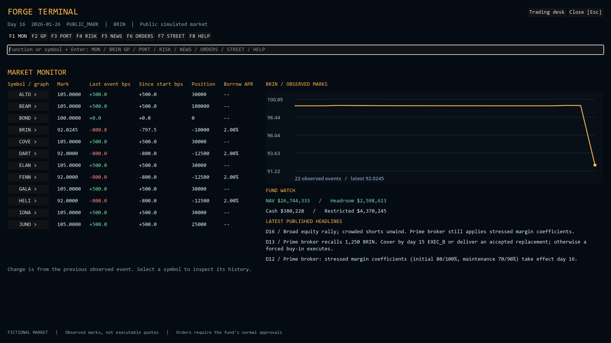
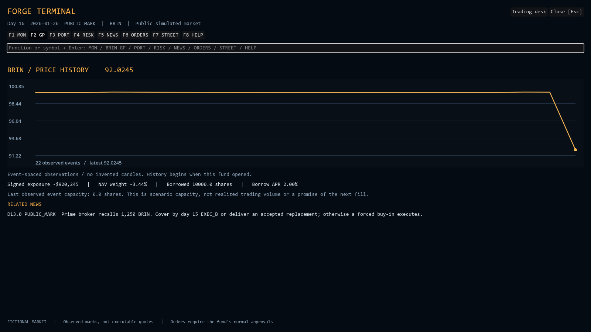
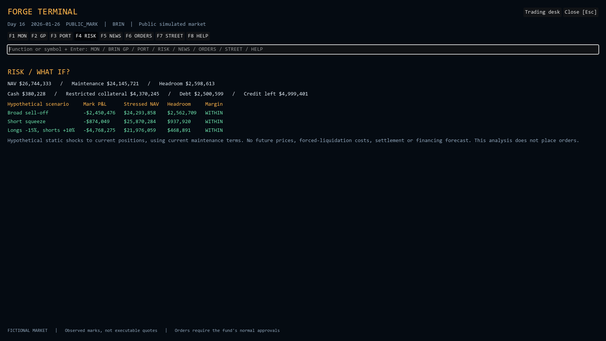

# Forge Terminal

Implemented 8 October 2026. This is FundForge's in-game financial workstation: a dense, keyboard-driven interface inspired by professional market terminals, with original branding and fictional simulation data. It is part of the Godot game, not a connection to Bloomberg or an external market-data service.

## Player workflow

Press **T**, choose **Terminal [T]** on the HUD, or open it from the trading-floor panel. Enter a function or a symbol, then press Enter. **F1-F9** select functions and **Escape** returns to the office. The **Trading desk** button returns to the existing ticket/package form; all partner signatures and risk checks still apply.

| Function | Implemented behavior |
|---|---|
| `MON` | All 12 scenario instruments: current marks, previous-event and since-start changes in bps, positions and weighted borrow APR. A second pane shows the selected security's history, fund headroom and recent published headlines. |
| `BRIN GP` / `GP` | Observed mark history, signed exposure, NAV weight, outstanding borrow and published headlines mentioning the security. Any known scenario symbol works. Entering a symbol alone opens its graph. |
| `PORT` | Signed holdings and market values, NAV weights, long/short totals. Short exposure is negative. |
| `RISK` | Current funding/exposure, three static shocks, plus a configurable liquidity/cure lab comparing two liquidation strategies and proposing first-event drafts. |
| `NEWS` | Published notices and research that has actually been revealed, newest first. |
| `ORDERS` | Accepted orders, quantities filled/remaining, status, fill records and broker-forced origin. Unsigned proposals remain in the committee panel. |
| `STREET` | Public rival-fund performance, style, status and rank; no rival positions. |
| `HELP` | Function directory and controls. |
| `REPLAY` | Completed-run causal timeline; reproduce baseline or omit one eligible decision and compare an isolated branch. |

Invalid commands explain the problem and preserve the current function. Refresh preserves unfinished command text. A two-second heartbeat runs only while the terminal is open; state-version changes also request a refresh. Unchanged snapshots do not rebuild the controls. Network failures label retained data stale, and a successful read clears that warning. Late responses cannot replace a newer snapshot. Arrow keys and world clicks do not move the avatar while the terminal is open. Opening it does not pause the server clock; use the HUD pause control before entering when you need thinking time.

## Actual screenshots

These PNGs were captured from the Godot client connected to the local FastAPI/PostgreSQL room created by the two-seat smoke script, at day 16. The room drew the rally variant. These are implementation captures, not design mockups or evidence of a human playtest.







## Data and authority contract

`GET /api/rooms/{room_id}/terminal` requires an existing seat bearer token scoped to that room. It reads a consistent session through `Store.session()` and returns `schema = forge-terminal-v1`, the room `version`, the processed-event `as_of`, quotes, history, current risk, published news, accepted orders and public league rows. This route creates no command or journal entry and does not change readiness or approvals. Quotes and risk remain shared. Research news is filtered by the authenticated seat: private findings appear only for their owner until explicitly shared.

`Engine.advance()` records one observation **after** the handler, cursor increment and reconciliation of each processed event. It records effective marks, after rival trading when applicable, rather than copying the unprocessed future tape. The observations are derived state: replay rebuilds them from accepted commands. No new database table or economic rules version is needed because postings, command results, journal hashes and trading rules are unchanged. Existing golden digests remain valid.

`terminal.snapshot()` uses current engine state and processed observations. It does not return the raw tape, variant, future marks, future margin terms, future volume, unrevealed research, opening-scenario secrets or rival holdings. Current margin rates are read at the processed day. The returned nested history, news references and fills are detached from the engine so a caller cannot mutate cached economic state through the projection.

Financial values are Decimal strings computed under the 40-digit `CTX`. The client converts them to floats only for formatting and plotting. All records retain their simulation date, day and phase. Change in bps is from the preceding **observed event**, not yesterday's close. Since-start return is anchored to the first processed observation even if chart history is truncated. Borrow APR is share-weighted across current loans, including replacement borrowing.

The response caps history at 512 observations, news at 100 notices and the blotter at 100 orders. The engine retains the whole scenario's observations so the opening anchor survives truncation. For a substantially longer campaign, measure session-copy/replay costs before adding snapshots or a separate historical query path.

## Stress methodology

For current long value `L`, absolute short value `S`, and side shocks `a` and `b`:

```text
mark P&L          = L*a - S*b
hypothetical NAV  = current NAV + mark P&L
maintenance       = long_rate*L*(1+a) + short_rate*S*(1+b)
headroom          = hypothetical NAV - maintenance
```

Presets are broad sell-off (-10%/-10%), short squeeze (0%/+20%), and adverse dispersion (-15%/+10%). They apply uniformly by position side; they are analytical assumptions, not modeled macro factors. A negative headroom flags a maintenance breach. Nonpositive NAV yields an undefined gross ratio instead of division by zero.

This is a **static mark-to-market sensitivity**, not a VaR estimate, probability forecast, margin-cure solver or forced-liquidation simulation. It excludes impact, settlement, collateral movements, fees, borrow inventory changes and future financing. The separate liquidity lab now models those stated mechanisms under frozen assumptions; these three static rows remain simple sensitivities. Current cash and collateral are displayed separately; restricted short proceeds never become spendable cash merely because a stress test runs.

## Implementation map

| Path | Responsibility |
|---|---|
| `backend/src/fundforge/engine.py` | Append processed-event observations after reconciliation. |
| `backend/src/fundforge/terminal.py` | Pure as-of read model, weighted borrow rates and Decimal static stresses. |
| `backend/src/fundforge/api.py` | Authenticated terminal read at one room version. |
| `game/scripts/forge_terminal.gd` | Workstation controls, navigation, public-data rendering, refresh and reconnect behavior. |
| `game/scripts/terminal_rules.gd` | Pure parser and presentation helpers. There is no trading grammar. |
| `game/scripts/terminal_chart.gd` | Observed-event line chart; flat/single-point/empty series are safe. |
| `game/scripts/hud.gd`, `main.gd`, `office3d.gd` | Entry points, trading-panel handoff and world input suppression. |
| `game/scripts/api.gd` | Existing bearer-authenticated HTTP transport. |
| `backend/tests/test_terminal.py` | Independent arithmetic, information boundaries, replay, auth, detached state and Postgres read inertness. |
| `game/tests/run_tests.gd` | Parser, every function's controls, chart rendering, connection recovery and preserved input. |
| `scripts/terminal_smoke.py` | Two-seat HTTP package approval/fill/terminal/verification smoke. |

## Validation on 8 October 2026

- Backend: **91 passed**, including PostgreSQL tests, via `uv run pytest -q` with `DATABASE_URL` set. The suite retains a Starlette/httpx deprecation warning and API-store connection-pool shutdown warnings; no assertion failed. These warnings are not declared fixed here.
- `uv run ruff check src tests`: passed. `uv run mypy -p fundforge`: passed, including strict checks on `terminal.py`.
- Godot **4.7.2**: **61 checks passed** using `--headless --path game --script res://tests/run_tests.gd`.
- Two-seat HTTP smoke: 12 quotes, 22 observations at day 16, command version 18, a 1,250-share BRIN cover filled, and persisted books verified. Self-signing was rejected and partner approval was required.
- Market, chart and risk controls were captured and visually inspected at 1600x900. The capture used the Compatibility renderer; the pre-existing office's Forward+ effects emit unsupported-effect warnings in that renderer. No terminal script errors occurred.

These are local results. No hosted deployment, GitHub Actions run, exported release, full graphical two-client test, gameplay study or performance benchmark is claimed.

## Next depth milestones

Follow the roadmap amendment. Liquidity drafts, completed-run omission replay, role-specific evidence and attention limits are implemented. Extend the independent execution/valuation controls to full administrator certification, then live presence and release verification. Each should change a player's decision or establish a measurable system property. A new broker, cache or analytics database needs a demonstrated workload and documented authority boundary.

## Liquidity and replay contracts, 9 October 2026

POST `/api/rooms/{room}/liquidity` requires a bearer seat and current `version`. Decimal-string assumptions: `long_shock` and `short_shock` in [-0.9, 1], `volume_scale` in [0.1, 2], integer `horizon` 1-10. Both strategies run on detached engine copies. Marks and current margin/borrow terms are frozen; capacity repeats the latest observed execution volume, never future tape. One execution per hypothetical business day includes T+1 settlements, collateral restrictions, credit limits and calendar-day borrow/debit/management accrual. The solver reserves one interval of current carry plus rounding cushion. No observed capacity, insolvency and exhausted horizons are explicit outcomes. A cure requires nonnegative margin headroom, funded collateral and settled obligations.

Strategies: greedy cost per unit of margin relief, or long sales before covers. Per-instrument bisection finds sufficient quantity under supported monotone marginal-cost bounds; adverse unsupported coefficients cause that instrument to be declined. This is not a globally optimal portfolio cure. Future news, rivals, recalls, investor flows and scheduled invoices are excluded and disclosed in each result. Results include every step, fills, first-event draft and exact assumptions. The draft is reviewed at the trading desk and proposed as a normal package, with distinct partner approval and live mandate/execution checks. `source_version` prevents submitting stale analysis. Computation and review alone issue no trade commands.

POST `/api/rooms/{room}/debrief` requires the current version and a completed run. No `omit_seq` reproduces the source digest exactly; an eligible decision sequence omits that single action and attempts the original suffix. Ready/tick version tokens rebase to the branch, but signatures and economic commands remain unchanged. Rejections and unfinished branches are explicit. Deterministic branch IDs bind rules, tape, source log and omitted decision. Reads neither persist branches nor advance live state. Arbitrary replacement strategies and persistent branch rooms remain future work.

Evidence: 173 backend tests, 69 Godot checks, Ruff/mypy, real two-seat HTTP smoke with unchanged PostgreSQL verification before/after analysis. Earlier screenshots show the original static terminal, not these new controls. Smoke recipe: `python scripts/analysis_smoke.py --server http://127.0.0.1:8011` (prints no seat tokens).

## Private research and independent controls, 10 October 2026

NEWS labels each entry SHARED or PRIVATE. The backend chooses visibility from the authenticated seat, not a query parameter. Before its reveal event even the owner cannot read evidence. Both seats see mandatory recalls/margin and public assignment activity; only the owner initially sees the finding. Sharing is an owner-authenticated command which makes the exact existing finding visible to both. Terminal, ordinary views and shared clock reasons are tested for leaks. Research desk controls exist in Godot and the secondary web client; the MP bot shares through normal logged commands.

RISK includes an execution/valuation control report. Its separate implementation rebuilds holdings from immutable fill confirmations, independently expands the cubic impact formula, and compares quoted values. A break blocks due redemption dealing. Conditional NAV uses book cash/liabilities: independent cash statements, financing and LP-claim certification are still pending, and the report says so.

Latest validation supersedes earlier counts: 192 backend tests with PostgreSQL, 74 Godot checks, Ruff/mypy and production web build. Local 8011 API runs rules 2026.10.6. The current two-seat smoke verifies private evidence before/after explicit sharing as well as both analysis tools. No public deployment or new graphical playtest claimed.

## Broker statement review, 11 October 2026

RISK now combines the execution checks with independent broker cash/loan balances and dated financing charges. It shows the number of activity, fee and statement records and an aged statement-break queue. Every published revision includes source, reported/expected balance, as-of event, availability event and correction reason. Matching corrections enable an MP-only review button, bound to the snapshot's room version and statement revision. Server-side authorization and reconciliation checks remain authoritative; review cannot edit money or erase history.

Select **Broker review challenge** in the Godot menu to play `case1-controls`: investigate a $100 opening cash discrepancy, wait for the day-13 correction and review it before the day-20 dealing close. Open breaks block new risk and dealing; reductions/payments continue. REPLAY can omit the review to show the missed dealing consequence. Standard Case1 includes a correct opening statement. Details and limits: [BROKER_CONTROLS](BROKER_CONTROLS.md).

Current evidence: 214 backend tests, 77 Godot checks, import/boot, lint/types and real two-seat HTTP challenge smoke. Rules 2026.10.7 / fixture 4.2.0. `checked` remains scoped; full administrator/LP certification is not implemented. Earlier screenshots and counts above are historical.

## Independent LP/fee panel, 11 October 2026

RISK now includes LP / FEE CHECK, independent units/net capital/provisions/HWM per series and dated redemption claims with price, payable and crystallized fee. The panel labels series capital as last-calendar-close values adjusted for dealt flows; it does not imply intraday P&L is already allocated. It reads only processed closes and actual claims. Incorrect fee/LP state blocks dealing; incorrect redemption candidates are refused before mutation. [Calculation contract and remaining shared inputs](ADMINISTRATOR_CONTROLS.md).

Latest evidence: 228 backend tests, 78 Godot checks, import/boot, lint/types and real HTTP validation on rules 2026.10.8. Fixture stays 4.2.0. No new graphical captures or full external certification claim.
