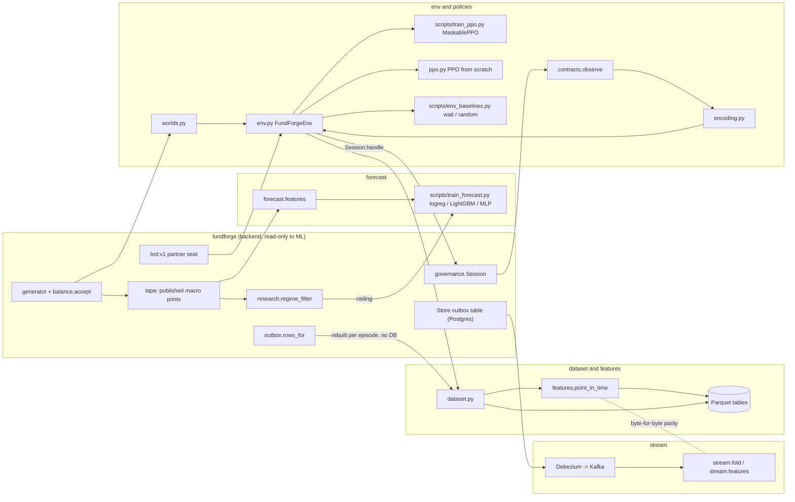

# FundForge ML lane

## What this is

FundForge is a deterministic hedge-fund simulator: Decimal accounting, an immutable journal, exact replay. This lane treats it as a lab for machine learning where the ground truth is known. The generator knows the hidden market regime, the exact Bayes posterior can be computed, and any policy can be replayed on any world. That makes it possible to check ML claims against truth, which real finance data never allows.

Models only advise or play a disclosed seat through the same commands a human uses (`Session.handle`). They never own fills, balances, NAV, fees, risk or approvals. Inputs come from the player's view or from as-of features with an explicit `available_at`. A leak-canary test plants future information and fails if any feature can see it.

What is here, in one line each:

- **Reinforcement learning:** a Gymnasium env with action masks. MaskablePPO is evaluated over 5 seeds with bootstrap intervals, and a PPO written from scratch (`src/fundforge_ml/ppo.py`) is compared with it. Also a masking ablation, a base/hard transfer matrix and VIPER distillation into a decision tree.
- **Forecasting:** a regime forecaster compared with the exact Bayes filter, with split-conformal prediction sets on top.
- **Evaluation methods:** off-policy evaluation (PDIS, WPDIS, FQE) checked against simulator truth, and value of information (does a better belief help the policy?).
- **Data:** a point-in-time dataset, anomaly detection on the books against rule-based controls, and OLS attribution against the generator's true factor.
- **Streaming:** Postgres outbox, then Debezium, then Kafka, with streamed features matching batch features byte for byte. The game runs with Kafka stopped.

## Architecture

Read the diagram left to right. The engine generates a world and runs the game. `env.py` wraps a `Session` as a Gymnasium env: an action becomes a governed command, the bot partner signs and readies, and the observation is the encoded player view. Policies (SB3 MaskablePPO, the from-scratch PPO, scripted baselines) only touch the env. The forecaster reads published macro prints, and the exact Bayes filter in the engine gives its ceiling. Episodes become point-in-time dataset rows. The same outbox rows that Postgres writes are streamed through Kafka and folded into features that must equal the batch ones.

Drawn from `src/fundforge_ml/` and `scripts/`. The engine (`fundforge`) never imports this package (`lint-imports`).



## How to reproduce

Needs Python 3.13 and [uv](https://docs.astral.sh/uv/). Everything runs on CPU; no paid services.

```sh
cd ml
uv sync                                    # core + dev tools (what CI runs)
uv run pytest -q                           # tests; training tests skip without the train group
uv run --group train pytest -q             # include torch / SB3 tests
uv run python scripts/render_results.py --check   # README table matches results/*.json
```

Each row in the table below has its exact command in the "Reproduce" column. Extra dependency groups: `train` (torch, SB3), `forecast` (LightGBM), `anomaly` (scikit-learn), `attribution` (statsmodels), `stream` (Kafka client). Model checkpoints (`results/*.zip`, `results/*.pt`) are git-ignored; each result JSON records the sha256 of the checkpoints it used.

## Results

Generated from `results/*.json` by `scripts/render_results.py`; CI-style check: `uv run python scripts/render_results.py --check`.

<!-- results:start -->
<!-- generated by scripts/render_results.py from results/*.json; do not edit by hand -->
| Experiment | Headline (interval) | Scale | Evidence | Reproduce |
|---|---|---|---|---|
| Books anomaly detection vs rule-based controls (B5 faults) | faults caught at 0.88% held-out FPR: Ledoit-Wolf 83/240, IsolationForest 0/240; controls catch every fault (see JSON per class) | 1 model seed; 240 faults (40 per class), 342 held-out clean checkpoints | [anomaly.json](results/anomaly.json) | `cd ml && uv run --group anomaly python scripts/train_anomaly.py --seeds 40 --clean-seasons 40` |
| Return attribution on the generator's true market factor (pooled OLS, cluster by world) | passive beta pre 1.16 [1.12, 1.2] -> post 0.745 [0.68, 0.81]; derisk_floor beta pre 0.634 [0.609, 0.658] -> post 0.613 [0.57, 0.655]; ppo beta pre 0.634 [0.593, 0.676] -> post 0.692 [0.571, 0.813]; true vs public-proxy factor corr 0.987; per-episode fits have 6-7 days (wide intervals) | 218 hard test worlds, 1526 episodes; PPO: 5 published hard checkpoints, sha256 verified against ppo_pm_hard.json | [attribution.json](results/attribution.json) | `cd ml && uv run --group train --group attribution python scripts/attribution.py --procs 4 --models C:/Users/krish/fundforge/ml/results` |
| M1 env throughput (this machine only) | single process pm 62.9 steps/s [61.4-66.1]; 32 workers 369 steps/s [260-422]; rollback snapshot 65% of profiled time | median of 5 reps, 6 worlds; Intel(R) Core(TM) i9-14900HX | [bench_env.json](results/bench_env.json) | `cd ml && uv run --group train python scripts/bench_env.py --seeds 4 --reps 5 --episodes 5 --vec-steps 40` |
| Split conformal sets for the LightGBM regime forecast | 95%: cov 0.951 [0.9464, 0.9559], both 0.0791, empty 0; 90%: cov 0.897 [0.8887, 0.905], both 0, empty 0.044; 80%: cov 0.806 [0.7966, 0.8159], both 0, empty 0.161 | 1056 scored / 1026 calibration test families | [conformal_forecast.json](results/conformal_forecast.json) | `cd ml && uv run --group forecast python scripts/conformal_forecast.py --worlds 20000` |
| Regime forecast: LightGBM vs exact Bayes filter | Brier gap to Bayes 0.000432, SE 0.00013 (by world); Brier 0.0577 vs Bayes 0.0572 | 1 training seed (20261015) x 2082 test families, n=18738 | [forecast.json](results/forecast.json) | `cd ml && uv run --group forecast python scripts/train_forecast.py --worlds 20000` |
| Outbox -> Kafka streamed vs batch features | live ok=True; game finished with Kafka stopped=True; recovered ok=True (306/306 events); no interval (pass/fail) | 1 room, n=306 outbox events | [kafka_e2e.json](results/kafka_e2e.json) | `deploy/kafka/fetch-debezium.sh && docker compose -f deploy/kafka/compose.yaml up -d --wait && cd ml && uv run --group stream python scripts/kafka_e2e.py` |
| Masking ablation: MaskablePPO vs PPO with an invalid-action penalty (base worlds) | paired reward masked - penalty 0.287 [0.151, 0.42], P(masked > penalty) 0.597; invalid picks 0.0054 (penalty arm) vs 0 | 3 seeds x 200000 steps per arm; 274 test worlds; masked arm = the published ppo_pm checkpoints (sha256 checked) | [mask_ablation.json](results/mask_ablation.json) | `cd ml && uv run --group train python scripts/mask_ablation.py --procs 6 --seeds 3 --steps 200000 --reuse` |
| Off-policy evaluation from random-play logs vs simulator truth (hard test worlds) | random: truth -0.743, PDIS -1.35, WPDIS -1.35, FQE -2.06, ESS 2.18e+03; ppo_eps0.5: truth 6.85, PDIS -0.0452, WPDIS -0.959, FQE -2.34, ESS 140; ppo_eps0.2: truth 7.15, PDIS -0.0034, WPDIS -0.865, FQE -2.75, ESS 109; ppo_greedy: truth 7.26, PDIS 0, WPDIS 0, FQE -2.95, ESS 0; wait: truth -6.22, PDIS 0, WPDIS 0, FQE -3.2, ESS 0. No estimator recovers PPO's value; see ope_noise_floor.json for the seed-set spread | 218 worlds x 10 logged episodes; truth 3 runs/world | [ope.json](results/ope.json) | `cd ml && uv run --group train --group forecast python scripts/ope_eval.py --procs 4` |
| OPE noise floor: random play's mean return across independent seed sets | seeds 10000+: mean -1.35 (SE 0.153); seeds 20000+: mean -0.558 (SE 0.153); seeds 30000+: mean -1.06 (SE 0.115); spread 0.796 | 218 worlds x 10 episodes per set | [ope_noise_floor.json](results/ope_noise_floor.json) | `cd ml && uv run --group train --group forecast python scripts/ope_noise_floor.py --procs 4` |
| MaskablePPO (pm seat) vs random, base worlds, selected on val | paired reward PPO - random 1.96 [1.72, 2.2]; P(PPO > random) 0.819; PPO IQM 8.12 [7.74, 8.48]; WIN rate PPO 100%, random 100% | 5 training seeds x 200000 steps; 274 test worlds (137 families) | [ppo_pm.json](results/ppo_pm.json) | `cd ml && uv run --group train python scripts/eval_ppo.py --seeds 5 --steps 200000 --families 3000 --procs 8` |
| MaskablePPO (pm seat) vs random, hard worlds, config fixed to lr1e-4_ent0.01 | paired reward PPO - random 4.96 [4.77, 5.18]; P(PPO > random) 0.857; PPO IQM 7.53 [7.25, 7.81]; WIN rate PPO 100%, random 53% | 5 training seeds x 200000 steps; 218 test worlds (109 families) | [ppo_pm_hard.json](results/ppo_pm_hard.json) | `cd ml && uv run --group train python scripts/eval_ppo.py --train-level hard --levels hard,base --seeds 5 --steps 200000 --families 3000 --grid lr1e-4_ent0.01 --procs 8` |
| Hard PPO vs scripted derisk_floor: action traces | first de-risk within +/-1 window of derisk_floor 100% (PPO at the first window 100%); Jaccard (day, reduce:SYM) mean 0.133 [IQR 0.125-0.143]; PPO reduces every derisk_floor name 0%; score PPO 251 vs floor 184 bps, PPO higher 76% | 5 training seeds x 200000 steps, config lr1e-4_ent0.01, the published hard checkpoints (sha256 verified); 1090 episodes on 218 test worlds | [trace_ppo_vs_floor.json](results/trace_ppo_vs_floor.json) | `cd ml && uv run --group train python scripts/trace_ppo_vs_floor.py --procs 4` |
| Generalisation matrix: PPO trained on base or hard worlds, tested on both | base->base: WIN 1370/1370, vs random 1.96 [1.72, 2.2]; hard->base: WIN 1370/1370, vs random 1.09 [1.01, 1.18]; base->hard: WIN 96/1090, vs random -2.71 [-3.01, -2.4]; hard->hard: WIN 1090/1090, vs random 4.96 [4.77, 5.18] | 5 published checkpoints per train level, 5 random runs, published test splits | [transfer_matrix.json](results/transfer_matrix.json) | `cd ml && uv run --group train python scripts/transfer_matrix.py --procs 4` |
| VIPER: PPO distilled into a decision tree | depth 4 (5 leaves): fidelity 0.846, tree - teacher 0.098 [-0.0114, 0.195] | teacher loaded (sha256 47bf3e0f032f), 1 seed; 30 test worlds | [viper_pm.json](results/viper_pm.json) | `cd ml && uv run --group train --with scikit-learn python scripts/distill_viper.py --teacher results/ppo_pm_lr1e-4_ent0.01_s0.zip --families 400 --workers 6 --depths 2,4,6,8 --iterations 10` |
| Value of information: P(stressed) added to the PPO observation | paired reward exact Bayes - none -0.00796 [-0.0773, 0.0611]; learned - none -0.0885 [-0.164, -0.00715] | 3 seeds per mode x 100000 steps; 96 test worlds (48 families) | [voi_pm.json](results/voi_pm.json) | `cd ml && uv run --group train --group forecast python scripts/train_voi.py --role pm --seeds 3 --steps 100000 --families 1000 --forecast-worlds 20000 --n-envs 4 --workers 4` |
<!-- results:end -->


## Limitations

- **Synthetic worlds only.** Every number comes from generated markets with known rules. Nothing here says anything about real markets.
- **Base worlds are easy.** Random valid play also wins every base test world, so base-level win rates do not separate policies; reward does. Hard worlds are where random play wins only about half the time.
- **Negative results are reported as negative:**
  - No OPE estimator recovers PPO's value from random-play logs: effective sample size collapses.
  - Adding the belief state does not improve PPO (value of information is within noise, or negative for the learned belief).
  - IsolationForest catches no injected fault at the held-out false-positive rate.
- **Small scales in places.** VIPER uses 1 seed and 30 test worlds. Value of information uses 3 seeds × 100k steps. Anomaly detection uses 1 model seed.
- **One machine.** Throughput numbers are from a single i9-14900HX laptop and are not portable.
