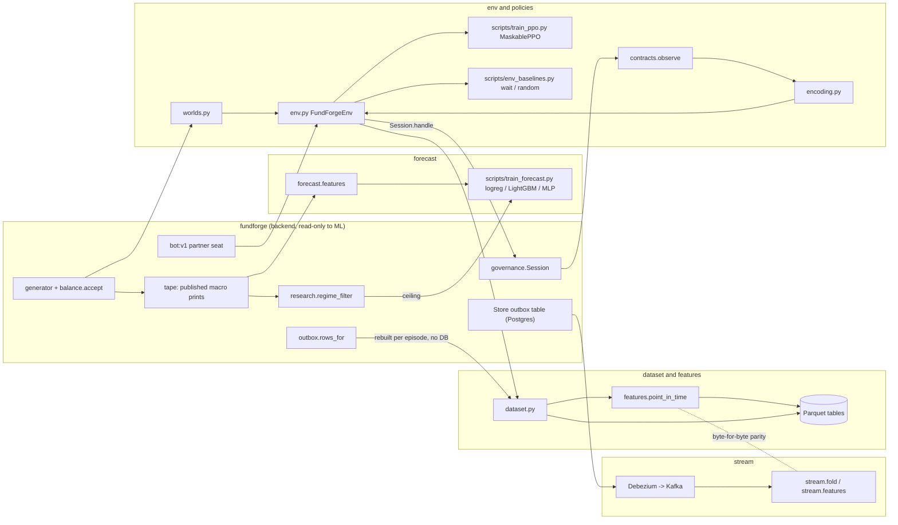

# FundForge ML lane

## What this is

<!-- owner writes: what this lane is, in your own words -->

## Architecture

<!-- owner writes: walk through the diagram below -->

Drawn from `src/fundforge_ml/` and `scripts/`. The engine (`fundforge`) never imports this package (`lint-imports`).

## How to reproduce

<!-- owner writes: setup steps and how to run each experiment (commands are in the table below) -->

## Results

Generated from `results/*.json` by `scripts/render_results.py`; CI-style check: `uv run python scripts/render_results.py --check`.

<!-- results:start -->
<!-- generated by scripts/render_results.py from results/*.json; do not edit by hand -->
| Experiment | Headline (interval) | Scale | Evidence | Reproduce |
|---|---|---|---|---|
| Books anomaly detection vs rule-based controls (B5 faults) | faults caught at 0.88% held-out FPR: Ledoit-Wolf 83/240, IsolationForest 0/240; controls catch every fault (see JSON per class) | 1 model seed; 240 faults (40 per class), 342 held-out clean checkpoints | [anomaly.json](results/anomaly.json) | `cd ml && uv run --group anomaly python scripts/train_anomaly.py --seeds 40 --clean-seasons 40` |
| Regime forecast: LightGBM vs exact Bayes filter | Brier gap to Bayes 0.000432, SE 0.00013 (by world); Brier 0.0577 vs Bayes 0.0572 | 1 training seed (20261015) x 2082 test families, n=18738 | [forecast.json](results/forecast.json) | `cd ml && uv run --group forecast python scripts/train_forecast.py --worlds 20000` |
| Outbox -> Kafka streamed vs batch features | live ok=True; game finished with Kafka stopped=True; recovered ok=True (306/306 events); no interval (pass/fail) | 1 room, n=306 outbox events | [kafka_e2e.json](results/kafka_e2e.json) | `deploy/kafka/fetch-debezium.sh && docker compose -f deploy/kafka/compose.yaml up -d --wait && cd ml && uv run --group stream python scripts/kafka_e2e.py` |
| MaskablePPO (pm seat) vs random, selected on val | paired reward PPO - random 0.603 [0.259, 1]; P(PPO > random) 0.667; PPO IQM 6.2 [5.85, 6.77]; random never loses tier (0%) | 3 training seeds x 2048 steps; 20 test worlds (10 families) | [ppo_pm.json](results/ppo_pm.json) | `cd ml && uv run --group train python scripts/eval_ppo.py --seeds 3 --steps 2048 --families 300 --grid lr3e-4_ent0.01,lr1e-4_ent0.01,lr3e-4_ent0 --random-runs 5 --procs 24` |
<!-- results:end -->

## What I built vs what AI built

<!-- owner writes: what you wrote, what Claude generated, what you rewrote, one AI suggestion you rejected and why -->

## Limitations

<!-- owner writes: what these results do not show -->
