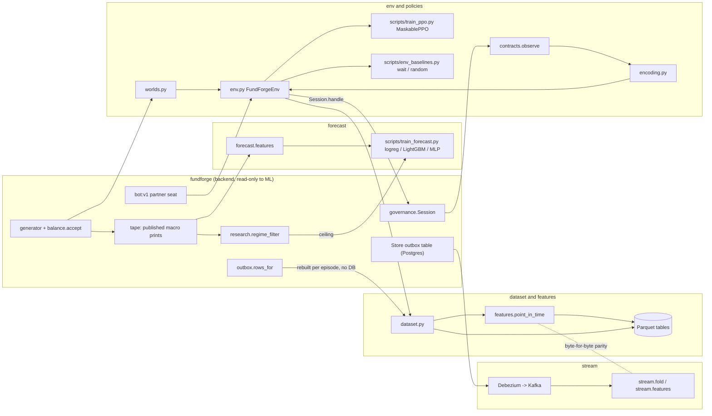

# FundForge ML lane

## What this is

<!-- owner writes: what this lane is, in your own words -->

## Architecture

<!-- owner writes: walk through the diagram below -->

Drawn from `src/fundforge_ml/` and `scripts/`. The engine (`fundforge`) never imports this package (`lint-imports`).

## How to reproduce

<!-- owner writes: setup steps and how to run each experiment (commands are in the table below) -->

## Results

Generated from `results/*.json` by `scripts/render_results.py`; CI-style check: `uv run python scripts/render_results.py --check`.

<!-- results:start -->
<!-- generated by scripts/render_results.py from results/*.json; do not edit by hand -->
| Experiment | Headline (interval) | Scale | Evidence | Reproduce |
|---|---|---|---|---|
| Books anomaly detection vs rule-based controls (B5 faults) | faults caught at 0.88% held-out FPR: Ledoit-Wolf 83/240, IsolationForest 0/240; controls catch every fault (see JSON per class) | 1 model seed; 240 faults (40 per class), 342 held-out clean checkpoints | [anomaly.json](results/anomaly.json) | `cd ml && uv run --group anomaly python scripts/train_anomaly.py --seeds 40 --clean-seasons 40` |
| M1 env throughput (this machine only) | single process pm 62.9 steps/s [61.4-66.1]; 32 workers 369 steps/s [260-422]; rollback snapshot 65% of profiled time | median of 5 reps, 6 worlds; Intel(R) Core(TM) i9-14900HX | [bench_env.json](results/bench_env.json) | `cd ml && uv run --group train python scripts/bench_env.py --seeds 4 --reps 5 --episodes 5 --vec-steps 40` |
| Regime forecast: LightGBM vs exact Bayes filter | Brier gap to Bayes 0.000432, SE 0.00013 (by world); Brier 0.0577 vs Bayes 0.0572 | 1 training seed (20261015) x 2082 test families, n=18738 | [forecast.json](results/forecast.json) | `cd ml && uv run --group forecast python scripts/train_forecast.py --worlds 20000` |
| Outbox -> Kafka streamed vs batch features | live ok=True; game finished with Kafka stopped=True; recovered ok=True (306/306 events); no interval (pass/fail) | 1 room, n=306 outbox events | [kafka_e2e.json](results/kafka_e2e.json) | `deploy/kafka/fetch-debezium.sh && docker compose -f deploy/kafka/compose.yaml up -d --wait && cd ml && uv run --group stream python scripts/kafka_e2e.py` |
| MaskablePPO (pm seat) vs random, base worlds, selected on val | paired reward PPO - random 1.96 [1.72, 2.2]; P(PPO > random) 0.819; PPO IQM 8.12 [7.74, 8.48]; WIN rate PPO 100%, random 100% | 5 training seeds x 200000 steps; 274 test worlds (137 families) | [ppo_pm.json](results/ppo_pm.json) | `cd ml && uv run --group train python scripts/eval_ppo.py --seeds 5 --steps 200000 --families 3000 --procs 8` |
| MaskablePPO (pm seat) vs random, hard worlds, config fixed to lr1e-4_ent0.01 | paired reward PPO - random 4.96 [4.77, 5.18]; P(PPO > random) 0.857; PPO IQM 7.53 [7.25, 7.81]; WIN rate PPO 100%, random 53% | 5 training seeds x 200000 steps; 218 test worlds (109 families) | [ppo_pm_hard.json](results/ppo_pm_hard.json) | `cd ml && uv run --group train python scripts/eval_ppo.py --train-level hard --levels hard,base --seeds 5 --steps 200000 --families 3000 --grid lr1e-4_ent0.01 --procs 8` |
| Hard PPO vs scripted derisk_floor: action traces | first de-risk within +/-1 window of derisk_floor 100% (PPO at the first window 100%); Jaccard (day, reduce:SYM) mean 0.133 [IQR 0.125-0.143]; PPO reduces every derisk_floor name 0%; score PPO 251 vs floor 184 bps, PPO higher 76% | 5 training seeds x 200000 steps, config lr1e-4_ent0.01, the published hard checkpoints (sha256 verified); 1090 episodes on 218 test worlds | [trace_ppo_vs_floor.json](results/trace_ppo_vs_floor.json) | `cd ml && uv run --group train python scripts/trace_ppo_vs_floor.py --procs 4` |
| VIPER: PPO distilled into a decision tree | SMOKE ONLY; depth 4 (6 leaves): fidelity 0.9, tree - teacher 0.0515 [0, 0.103] | teacher 8192 steps, 1 seed; 2 test worlds | [viper_pm.json](results/viper_pm.json) | `cd ml && uv run --group train --with scikit-learn python scripts/distill_viper.py --steps 8192 --families 40 --workers 16 --depths 2,4 --iterations 2` |
| Value of information: P(stressed) added to the PPO observation | paired reward exact Bayes - none -0.00796 [-0.0773, 0.0611]; learned - none -0.0885 [-0.164, -0.00715] | 3 seeds per mode x 100000 steps; 96 test worlds (48 families) | [voi_pm.json](results/voi_pm.json) | `cd ml && uv run --group train --group forecast python scripts/train_voi.py --role pm --seeds 3 --steps 100000 --families 1000 --forecast-worlds 20000 --n-envs 4 --workers 4` |
<!-- results:end -->

## What I built vs what AI built

<!-- owner writes: what you wrote, what Claude generated, what you rewrote, one AI suggestion you rejected and why -->

## Limitations

<!-- owner writes: what these results do not show -->
